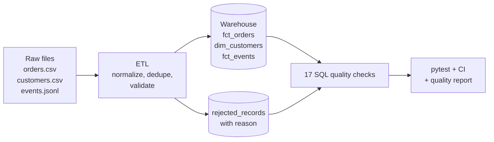

# Data Pipeline QA: testing an e-commerce ETL end to end

[](https://github.com/albertsilvawd/data-pipeline-qa/actions/workflows/data-tests.yml)

A small but complete example of **data test engineering**: an ETL pipeline that loads e-commerce orders and analytics events into a warehouse, and an automated test suite that proves the data that lands there is complete, consistent and trustworthy.

The raw data is deliberately messy (duplicates, two date formats, orphan records, broken tracking events), the same problems real source systems produce. The pipeline must clean or quarantine every bad row, and the tests verify it did.

## What this project demonstrates

| Skill | Where |
|---|---|
| ETL / data pipeline testing | [`pipeline/etl.py`](pipeline/etl.py), [`tests/test_etl_transformations.py`](tests/test_etl_transformations.py) |
| SQL data quality checks | [`pipeline/quality.py`](pipeline/quality.py): 17 checks written as SQL |
| Source-to-target reconciliation | row counts and amounts balance between raw files and warehouse |
| Analytics / event validation | [`contracts/tracking_plan.json`](contracts/tracking_plan.json) + [`tests/test_event_contracts.py`](tests/test_event_contracts.py) |
| BigQuery | [`sql/bigquery/`](sql/bigquery/): the same checks on Google's public `thelook_ecommerce` dataset |
| Test automation & CI | pytest, 45 tests, run on every push by [GitHub Actions](.github/workflows/data-tests.yml) |
| Shell scripting | [`scripts/run_quality_checks.sh`](scripts/run_quality_checks.sh) |

## How it works



Every raw row ends up in exactly one place: **loaded**, **removed as a duplicate**, or **rejected with a reason**. That is what makes reconciliation possible:

```
raw_orders (1020) = duplicates_removed (20) + orders_loaded (974) + orders_rejected (26)
```

## The test suite

| Category | What it checks |
|---|---|
| Completeness | required fields are never null |
| Uniqueness | primary keys (order, customer, event) are unique |
| Referential integrity | every order belongs to an existing customer |
| Validity | accepted status values, positive quantities, `total = quantity × price`, dates in range, valid emails |
| Reconciliation | row counts and revenue balance between source and warehouse |
| Event validation | events follow the tracking plan; each `purchase` event matches a real order (same value, same customer, not cancelled); tracking coverage ≥ 95% |
| **Testing the tests** | [`test_checks_detect_defects.py`](tests/test_checks_detect_defects.py) corrupts a copy of the warehouse on purpose (deletes a row, breaks a total, creates an orphan) and asserts each check **fails**. A check that can never fail proves nothing. |

## Run it

```bash
git clone https://github.com/albertsilvawd/data-pipeline-qa.git
cd data-pipeline-qa
python -m venv .venv && source .venv/bin/activate   # Windows: .venv\Scripts\activate
pip install -r requirements.txt

bash scripts/run_quality_checks.sh   # generate data -> ETL -> tests -> report
```

Or step by step:

```bash
python scripts/generate_data.py      # raw data with seeded defects
python -m pipeline.etl               # load the warehouse (data/warehouse.db)
python -m pytest -v                  # run the 45 tests
python -m pipeline.quality           # write reports/data_quality_report.md
```

A sample output is in [`reports/data_quality_report.md`](reports/data_quality_report.md).

## BigQuery

The queries in [`sql/bigquery/`](sql/bigquery/) apply the same rules to `bigquery-public-data.thelook_ecommerce` (orders, order items, users and web events). They run in the free [BigQuery sandbox](https://cloud.google.com/bigquery/docs/sandbox), with no credit card. Each query returns the rows that break a rule, so zero rows means the check passed.

## Project structure

```
contracts/tracking_plan.json   event contract (JSON Schema)
pipeline/etl.py                extract, transform, load + quarantine
pipeline/quality.py            SQL data quality checks + report
scripts/generate_data.py       synthetic data with realistic defects
scripts/run_quality_checks.sh  end-to-end run
sql/bigquery/                  checks on the BigQuery public dataset
tests/                         pytest suite
```

## Tech

Python · pandas · SQL (SQLite and BigQuery Standard SQL) · pytest · JSON Schema · Bash · GitHub Actions

---

Built by **Albert Silva**, data analyst moving into data quality engineering. [LinkedIn](https://www.linkedin.com/in/albertvsilva)
